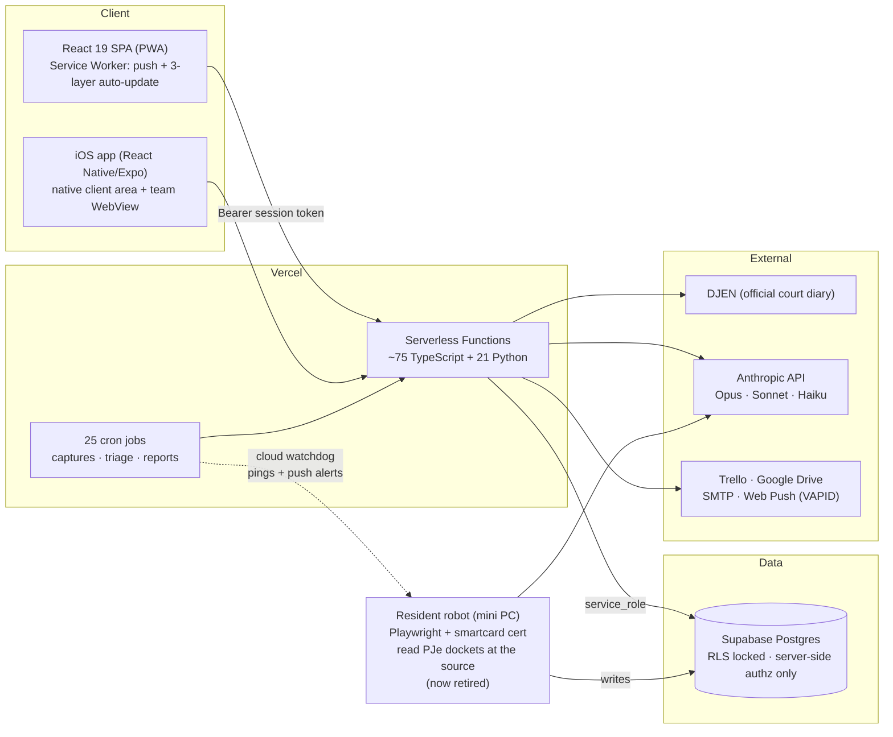
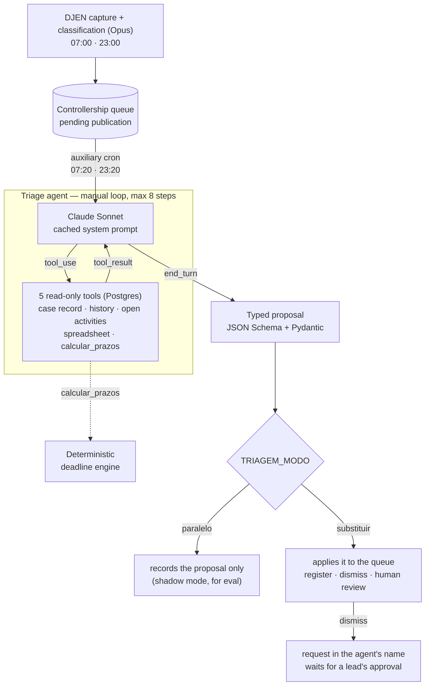
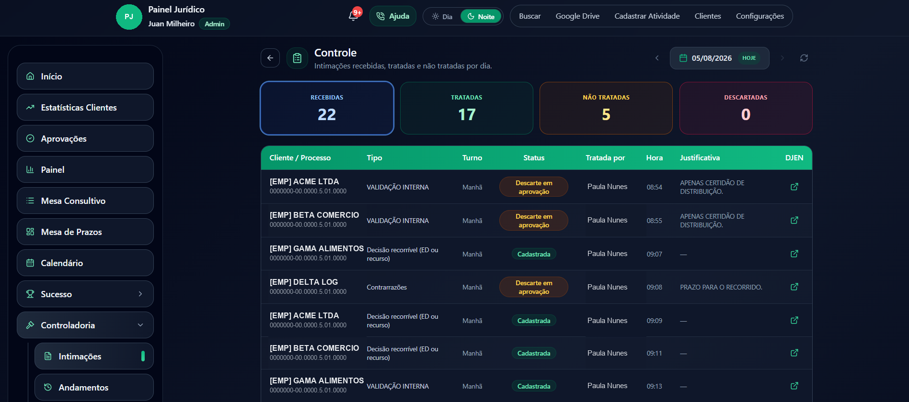
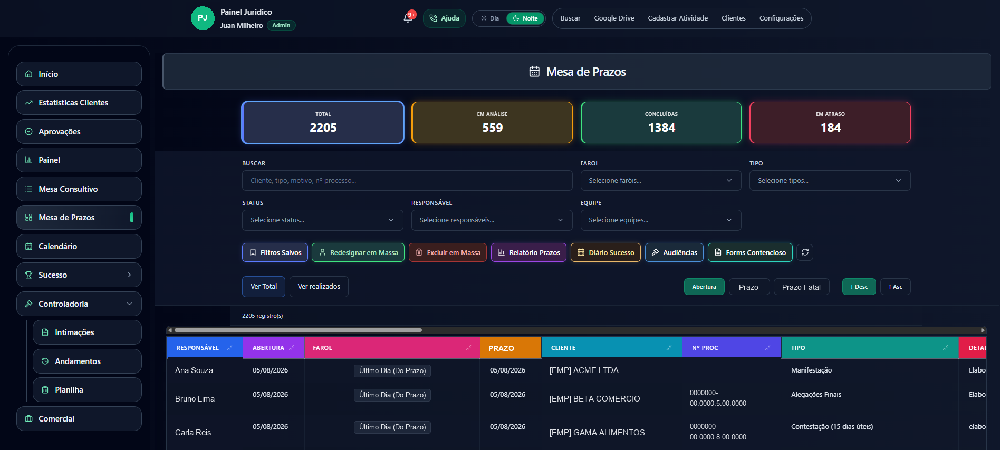
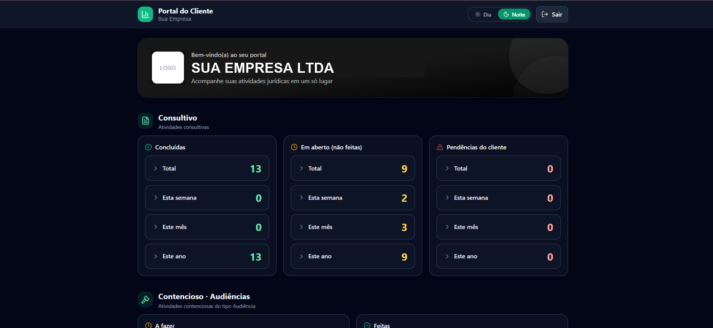
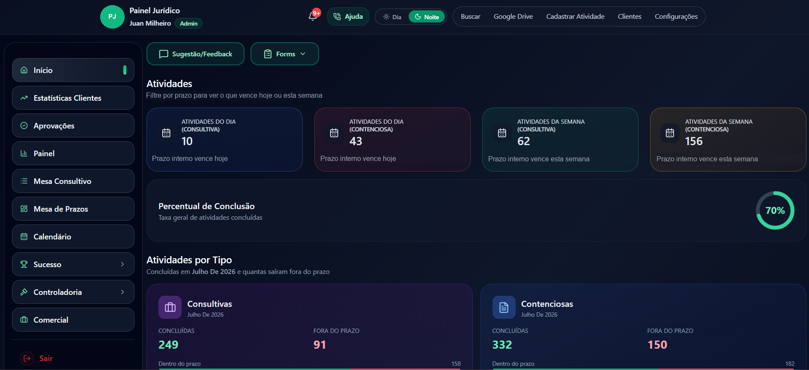

# Legal Ops AI — Production Case Study

> **[Versão em português →](./README.md)**

A legal operations platform I designed, built and operate solo for a multi-team law firm in Brazil. In production since **2025**, used daily by the whole firm — lawyers, controllers, customer success and the firm's own clients.

This is a **case study repository**: the product is proprietary and the full source stays private. What you'll find here is the architecture, the engineering decisions, sanitized code excerpts from the AI pipelines, and the lessons learned from operating LLMs in production. All names, parties and case numbers in examples are fictional.

---

## The numbers

| | |
|---|---|
| In production | since 2025, no dedicated ops team — just me |
| Lawsuits tracked | ~1,060 across the firm's portfolio |
| AI pipelines shipped to production | 4 — court-diary classification, the triage agent and batch summarization still running; the docket robot was deliberately retired (its story below) |
| Serverless functions | ~95 (TypeScript + Python, same repo, same deploy) |
| Scheduled jobs | 25 Vercel crons (captures, triage, reports, pushes, syncs) |
| Clients | mobile-first PWA + native iOS app on the App Store |

## What it does

The firm lives and dies by **court deadlines**. The platform runs that entire operation:

- **Deadline desks** — litigation and consulting activity boards with a traffic-light system driven by two deadline layers (the firm's internal deadline vs. the fatal legal one)
- **Court-diary controllership (AI)** — automatically captures every publication addressed to the firm from Brazil's official court diary (DJEN), has **Claude Opus** read and classify each one, computes the legal deadline deterministically, and turns it into a tracked activity in one click
- **Court robot (AI)** — a resident robot that logged into the labor-court system (PJe) with an A3 smartcard certificate, read case dockets from the primary source, and had **Claude Haiku** produce an analyst-grade briefing per movement — severity-labeled *act / look / record / routine*. Shipped, operated, and later deliberately retired ([the full story](#3-docket-analysis--claude-haiku-reading-raw-court-files))
- **Client portal** — each client company gets its own dashboard (white-labeled, iOS app included)
- Plus: two-step approval queues, a leads CRM, monthly `.docx` reports per client uploaded to Google Drive, daily team reports by e-mail, self-hosted web push, full audit trail with soft deletes, 1-way Trello sync.

## Architecture



Design rule #1: **the browser never talks to the database.** Auth is a custom session-token scheme (Argon2id passwords); every read/write goes through a serverless function that re-checks role and team server-side. Hiding a button is cosmetics — the function is the gate.

Design rule #2: **one repo, one deploy.** TypeScript and Python functions live side by side; a `git push` to main ships frontend, backend, crons and headers atomically.

## The AI engineering (the interesting part)

### 1. Court-diary classification — Claude Opus + a deterministic deadline engine

Twice a day, a Python function captures every publication addressed to the firm from the official court diary. Each one goes through Opus with a **structured-extraction prompt** that returns strict JSON:

```
rito · court level · decision type · does it demand action from the firm?
is it a hearing? · literal deadline written in the text · topic summary
which party is our client · confidence 0..1 · needs_human_review
```

The key decision: **the LLM never computes deadlines.** Brazilian procedural deadlines are calendar math with rules (business days, rito-dependent counts, ED-first strategies) — that's handled by a deterministic Python engine **validated against the firm's own answer-key spreadsheet**. The model only extracts what code can't parse from free-form legal prose. See [`excerpts/docket_classifier.py`](./excerpts/docket_classifier.py).

The prompt is not generic: it encodes the firm's actual operating doctrine (e.g. *"an order to pay is the client's decision, not a lawyer's filing — classify as internal validation even when there's a deadline"*). When the model misclassifies, the fix goes into the prompt the way a correction goes into a junior analyst's manual.

**Human-in-the-loop by design:** nothing becomes a tracked deadline without a person clicking *Register* — and nothing gets discarded without a team-leader approval. The AI proposes; the workflow disposes.

### 2. Triage agent — Claude Sonnet with tools, measured before it was built

In production since September 2026, layered on top of the previous pipeline. The classifier reads each publication **in isolation**; the agent reads it **in the context of its case**. Twenty minutes after every capture, it checks the case record, the earlier publications on the same case, the activities already open on the deadline desk and the controllership spreadsheet, and hands the team a **ready-made proposal**: register (with the deadline already computed by the engine), dismiss (with the justification the team would write) or send to human review.

**Measure before designing.** Before writing any code, I measured production: about **24 publications a day**, **38% dismissed by hand**, and **a third of the dismissals were duplicates** — the same act captured again, already handled by the team. A classifier that only sees the text can't know that. The agent had to see what the team had already decided, and each tool came from a question the manual triage was asking:

| Triage question | Tool (read-only) |
|---|---|
| Has this act already been through the queue? (the duplicate third) | `historico_intimacoes` — earlier publications on the same case, with the team's decision and the justification for each dismissal |
| Is the deadline already tracked on the desk? | `atividades_abertas` |
| Who is the client? Is the case active or archived? | `consultar_cadastro_processo` |
| Is this a strategically tracked case? | `planilha_controladoria` — phase, strategy, risk, next action |
| What's the deadline? | `calcular_prazos` — runs the deterministic engine on the proposed classification. **The deadline stays deterministic** |

The dismissal reasons came from the measurement too: the schema's closed list is the team's real list of justifications, most common first.



**Design.**

- **Claude Sonnet, manual tool-use loop.** Call the model → `tool_use` → execute → return `tool_result` → repeat, capped at **8 steps**. No SDK tool runner, no framework: more lines, but every decision stays visible. If a tool throws, the error goes back to the model as a `tool_result` with `is_error` and the run doesn't crash.
- **Strict, read-only tools.** The API guarantees the arguments arrive in the schema's shape. The agent writes nothing: the cron that calls it does the writing.
- **Structured output enforced by the API, validated again on arrival.** The JSON Schema is generated from the Pydantic model and sent as the output format; the response goes through `Proposta.model_validate_json`. Every decision field is a closed `Literal`: if the model writes `"cadastro"` instead of `"cadastrar"`, validation fails and the error is logged, instead of an unexpected value reaching the database. Field order is deliberate — reasoning first, confidence last.
- **The deadline stays in code.** `calcular_prazos` takes the classification in the same schema as the final proposal and runs the existing engine. If the model changes its mind after computing, the code recomputes from the final classification.
- **Prompt caching.** The system prompt — triage instructions plus the classifier's rules, reused — is identical for every publication and is sent with `cache_control`.
- **Agent version recorded in every proposal**, alongside model, effort, steps, tools called, tokens, cost and latency. Change the prompt, bump the version; comparing versions is the eval's job.

The output contract (see [`excerpts/triage_agent.py`](./excerpts/triage_agent.py)):

```python
Acao = Literal["cadastrar", "descartar", "revisar_humano"]   # register / dismiss / human review
MotivoDescarte = Literal["nao_se_aplica", "duplicado", "cliente_fora_do_fluxo",
                         "sem_prazo_aberto", "prazo_da_parte_contraria",
                         "certidao_distribuicao", "processo_encerrado_ou_arquivado",
                         "outro"]

class Proposta(BaseModel):
    raciocinio: str               # what the act asks for, what the tools showed, why
    classificacao: Classificacao  # the same fields the deadline engine already consumed
    acao: Acao
    motivo_descarte: MotivoDescarte
    justificativa: str            # ready for the dismissal field or the registration summary
    evidencias: List[str]         # facts verified through the tools
    confianca: float = Field(ge=0, le=1)
```

**Left out on purpose.** No LangChain, no RAG, no external queue. The decision was written down before the code, with the trigger that would bring each one in:

| Left out | Trigger that would bring it in |
|---|---|
| LangChain | a 2nd provider or a 2nd agent |
| LangGraph | branching, or a human **in the middle** of the run — here the human is at the end |
| RAG / pgvector | a corpus of free text entering the decision — the context that decides is structured and comes from the tools; the rules travel in the prompt |
| External queue / Redis | runs of dozens of steps with durable state mid-run — the batch fits an auxiliary cron, and whatever doesn't fit in one round waits for the next |
| Fine-tuning | a systematic error proven by eval |

**Safety: the agent proposes, a lead approves.**

| Mode (`TRIAGEM_MODO`) | Effect |
|---|---|
| `paralelo` (default) | **Shadow mode**: only records the proposal next to the publication; the queue doesn't change. This is the eval mode |
| `substituir` (what runs in production) | Applies the proposal to the queue — if the publication is still pending. The cron re-reads the row first: if someone already handled it, it backs off |

- In `substituir`, **cadastrar** (register) rewrites the publication with the agent's classification and the engine's deadlines, and the team confirms as usual. **Descartar** (dismiss) opens a dismissal request **in the agent's name**, which lands in the same lead approval a team member's request goes through: **nothing leaves the queue without a lead's approval**. **Revisar_humano** (human review) flags the publication for review with the reason.
- **Low confidence goes to human review.** The prompt requires `revisar_humano` below 0.6 — and also when the client isn't in the case record, the case number is missing, or the text is truncated or contradicts the record. A proposed registration below 0.7 confidence arrives flagged for review.
- **Kill switch:** `TRIAGEM_AGENTE_ATIVA=0` turns the agent off; `TRIAGEM_MODO=paralelo` goes back to shadow mode. Both are environment variables, no code change.

**Evaluation: the method.** An offline script compares the agent's proposal with the human decision, writing nothing to the database:

1. Takes publications the team has **already decided**, in a sample balanced between registered and dismissed.
2. Re-fetches each one's text from DJEN.
3. Runs the agent with a **temporal cut**: the tools only see records created **before** that publication. Without the cut, the agent would see the activities, the derived rows and the dismissal that the publication itself generated later — in other words, the team's decision — and the answer key would leak into the exam (the typical case: the publication "sees" its own trail and decides it's a duplicate). In production the cut is empty, because the agent runs on a pending publication that hasn't left a trail yet.
4. Prints an **agreement matrix** (proposal × human decision), plus cost and latency per publication.

Model, effort and agent version are script parameters: the same sample runs against another model or another prompt version, and the numbers stay comparable.

### 3. Docket analysis — Claude Haiku reading raw court files

The resident robot logs into the labor-court system with a hardware certificate (Playwright + Windows UI automation + TOTP), pulls each case's **timeline and the actual PDFs** from the authenticated API, and sends them to Haiku as native document blocks — no OCR pipeline, no text extraction step.

The system prompt is a hand-written **analyst manual** — a method of 7 questions the model applies as internal reasoning, forbidden from showing in the output. The output contract is fixed: a severity label (**ACT / LOOK / RECORD / ROUTINE**), a one-paragraph case summary, and — only when action is needed — a structured action card. See [`excerpts/docket_analyst.py`](./excerpts/docket_analyst.py).

**Model tiering by cost of error:** Opus for the classification that creates legal deadlines (low volume, catastrophic miss cost), Haiku for high-volume docket reading (a bad summary is annoying, not dangerous). Same platform, two price points, chosen deliberately.

**Epilogue — shipped, measured, retired.** This was the hardest engineering in the project (hardware certificate login, WAF-imposed throttling, crash-safe state on a machine that gets unplugged) and it worked. But the weekly coverage report kept saying the quiet part out loud: the robot could only reach ~39% of the portfolio — the rest lived in other court systems or behind pending bar registrations — so the legacy data provider could never be turned off. Once the need it served had passed, I decommissioned it rather than pay the operational cost of two overlapping sources indefinitely. Retiring a working pipeline because the data says so is as much AI engineering as shipping it.

### 4. Operating LLMs in production — what actually broke

The parts you only learn by running this for months:

- **Response-shape drift.** A batch-summary integration silently changed its payload shape; the parser started returning empty. Fix: defensive parsing + a searchable log marker for "response didn't match", so the next drift is a log query away, not a mystery.
- **Ordering starvation.** An hourly capture job ordered ascending with a result limit — once the backlog outgrew the limit, *the current day never arrived*. Classic pagination bug, but with an LLM pipeline downstream it looks like "the AI stopped working". Fix: descending order + bigger window.
- **Anchor on event time, not capture time.** Summaries were being dated by when the robot *saw* them, not when they *happened* — wrong day buckets in every report. Backfilled 35 rows.
- **The machine turns off.** The robot runs on a mini PC in an office. Its alert-capture window is **adaptive** — sized by the gap since the last successful run — so a power cut loses nothing. A cloud watchdog cron checks its heartbeat hourly and pushes an alert if it goes quiet — see [`excerpts/robot_watchdog.ts`](./excerpts/robot_watchdog.ts).
- **The source bans you.** The court's WAF rate-bans burst traffic; captures are throttled and spread across three staggered loops (`:00` inbox / `:30` drip / `:45` alert-triggered).
- **Know your coverage.** The robot covered 39% of the portfolio (the rest was other courts or pending bar registrations) — measured by a weekly coverage report, which is why the legacy data provider was never turned off, and ultimately what informed the decision to retire the robot. If you don't measure coverage, you don't have a pipeline, you have a demo.

## Engineering highlights beyond AI

- **PWA auto-update in 3 layers** — after every deploy, every open tab updates itself politely (idle/hidden-tab reload, route preserved). Nobody at the firm has ever been told to "clear cache".
- **Self-hosted web push** (VAPID, no Firebase): deadline alerts, controllership digests, robot watchdog alerts.
- **Soft-delete audit** — deletes move rows to mirror `exc_*` tables; nothing is ever lost, mass-delete is restricted to one admin.
- **Serverless Python with real constraints** — the monthly report generator hit the 300 s function limit rebuilding Drive credentials per client; caching them brought it down, and `maxDuration: 800` covers the tail.
- **Security posture** — RLS locked down so the public anon key can do nothing; verified by an actual pentest of my own API. Argon2id-only password storage (legacy SHA-256 column dropped after migration).

## Screenshots

*All data in the screenshots is fictional (redacted from production captures).*

**Controllership — daily control view**: every publication captured from the official court diary, classified by Claude Opus, and tracked through the human-in-the-loop workflow (registered / discard pending leader approval):



**Deadline desk** — the litigation board: two-layer traffic lights (internal deadline vs. fatal legal deadline), saved filters, mass actions, per-team views:



**Client portal** — each client company gets its own white-labeled dashboard (also shipped as the native iOS app):



**Home** — last month's closed numbers per activity type (done vs. late), plus what's due today and this week:



## Stack

React 19 · TypeScript · Vite 7 · Tailwind · PWA (custom Service Worker) · Vercel Functions (Node + Python) · Supabase Postgres · Anthropic API (Claude Opus / Sonnet / Haiku) · Playwright · React Native/Expo · web-push · nodemailer · Google APIs

---

*The full source is private (it operates a live legal practice). Excerpts here are sanitized: identities removed, examples fictional, logic real. Happy to walk through any part of it in depth — [open an issue](../../issues) or reach out.*
