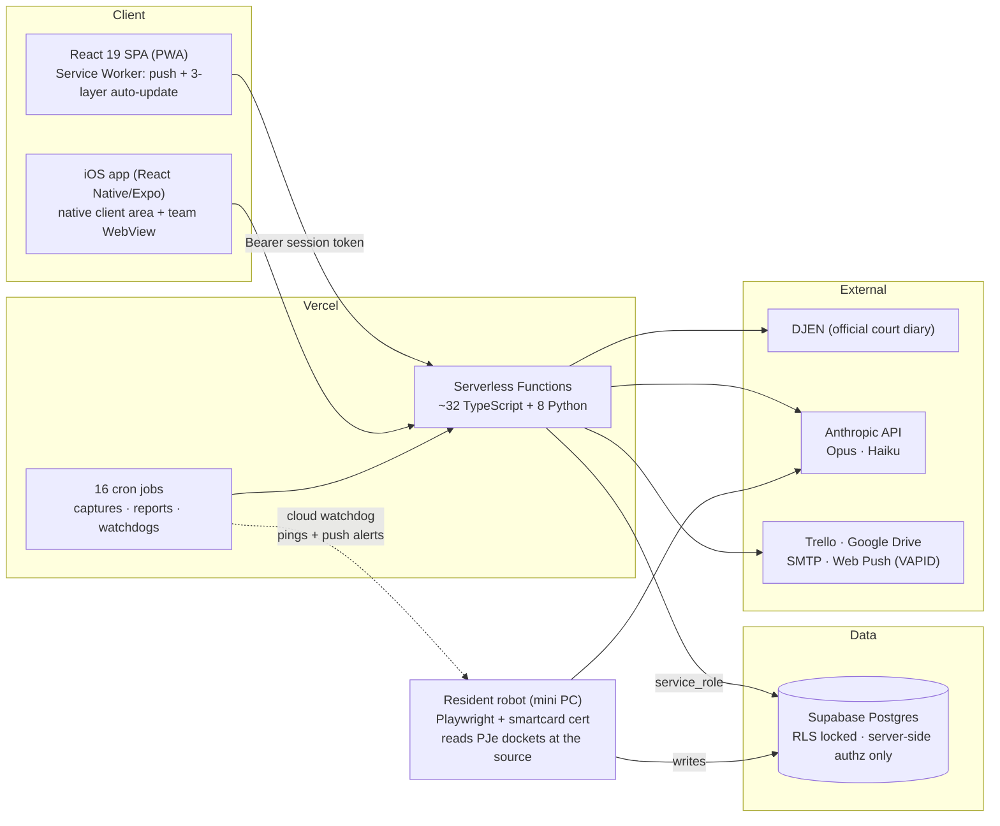
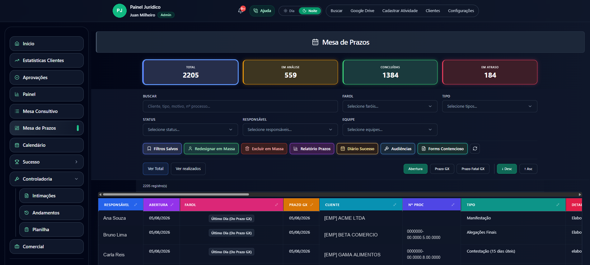
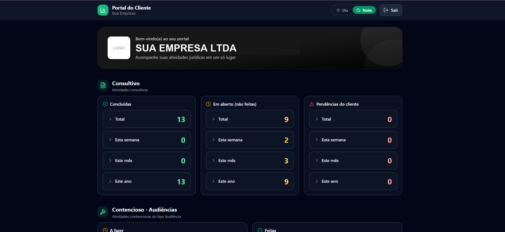

# Legal Ops AI — Production Case Study

> **[Versão em português →](./README.pt-BR.md)**

A legal operations platform I designed, built and operate solo for a multi-team law firm in Brazil. In production since **May 2026**, used daily by the whole firm — lawyers, controllers, customer success and the firm's own clients.

This is a **case study repository**: the product is proprietary and the full source stays private. What you'll find here is the architecture, the engineering decisions, sanitized code excerpts from the AI pipelines, and the lessons learned from operating LLMs in production. All names, parties and case numbers in examples are fictional.

---

## The numbers

| | |
|---|---|
| In production | since May 2026, no dedicated ops team — just me |
| Lawsuits tracked | ~1,060 across the firm's portfolio |
| AI pipelines in production | 3 (court-diary classification · docket analysis · batch summarization) |
| Serverless functions | ~40 (TypeScript + Python, same repo, same deploy) |
| Scheduled jobs | 16 Vercel crons (captures, reports, pushes, watchdogs) |
| Clients | mobile-first PWA + native iOS app on the App Store |

## What it does

The firm lives and dies by **court deadlines**. The platform runs that entire operation:

- **Deadline desks** — litigation and consulting activity boards with a traffic-light system driven by two deadline layers (the firm's internal deadline vs. the fatal legal one)
- **Court-diary controllership (AI)** — automatically captures every publication addressed to the firm from Brazil's official court diary (DJEN), has **Claude Opus** read and classify each one, computes the legal deadline deterministically, and turns it into a tracked activity in one click
- **Court robot (AI)** — a resident robot that logs into the labor-court system (PJe) with an A3 smartcard certificate, reads case dockets from the primary source, and has **Claude Haiku** produce an analyst-grade briefing per movement — severity-labeled *act / look / record / routine*
- **Client portal** — each client company gets its own dashboard (white-labeled, iOS app included)
- Plus: two-step approval queues, a leads CRM, monthly `.docx` reports per client uploaded to Google Drive, daily team reports by e-mail, self-hosted web push, full audit trail with soft deletes, 1-way Trello sync.

## Architecture



Design rule #1: **the browser never talks to the database.** Auth is a custom session-token scheme (Argon2id passwords); every read/write goes through a serverless function that re-checks role and team server-side. Hiding a button is cosmetics — the function is the gate.

Design rule #2: **one repo, one deploy.** TypeScript and Python functions live side by side; a `git push` to main ships frontend, backend, crons and headers atomically.

## The AI engineering (the interesting part)

### 1. Court-diary classification — Claude Opus + a deterministic deadline engine

Twice a day, a Python function captures every publication addressed to the firm from the official court diary. Each one goes through Opus with a **structured-extraction prompt** that returns strict JSON:

```
rito · court level · decision type · does it demand action from the firm?
is it a hearing? · literal deadline written in the text · topic summary
which party is our client · confidence 0..1 · needs_human_review
```

The key decision: **the LLM never computes deadlines.** Brazilian procedural deadlines are calendar math with rules (business days, rito-dependent counts, ED-first strategies) — that's handled by a deterministic Python engine **validated against the firm's own answer-key spreadsheet**. The model only extracts what code can't parse from free-form legal prose. See [`excerpts/docket_classifier.py`](./excerpts/docket_classifier.py).

The prompt is not generic: it encodes the firm's actual operating doctrine (e.g. *"an order to pay is the client's decision, not a lawyer's filing — classify as internal validation even when there's a deadline"*). When the model misclassifies, the fix goes into the prompt the way a correction goes into a junior analyst's manual.

**Human-in-the-loop by design:** nothing becomes a tracked deadline without a person clicking *Register* — and nothing gets discarded without a team-leader approval. The AI proposes; the workflow disposes.

### 2. Docket analysis — Claude Haiku reading raw court files

The resident robot logs into the labor-court system with a hardware certificate (Playwright + Windows UI automation + TOTP), pulls each case's **timeline and the actual PDFs** from the authenticated API, and sends them to Haiku as native document blocks — no OCR pipeline, no text extraction step.

The system prompt is a hand-written **analyst manual** — a method of 7 questions the model applies as internal reasoning, forbidden from showing in the output. The output contract is fixed: a severity label (**ACT / LOOK / RECORD / ROUTINE**), a one-paragraph case summary, and — only when action is needed — a structured action card. See [`excerpts/docket_analyst.py`](./excerpts/docket_analyst.py).

**Model tiering by cost of error:** Opus for the classification that creates legal deadlines (low volume, catastrophic miss cost), Haiku for high-volume docket reading (a bad summary is annoying, not dangerous). Same platform, two price points, chosen deliberately.

### 3. Operating LLMs in production — what actually broke

The parts you only learn by running this for months:

- **Response-shape drift.** A batch-summary integration silently changed its payload shape; the parser started returning empty. Fix: defensive parsing + a searchable log marker for "response didn't match", so the next drift is a log query away, not a mystery.
- **Ordering starvation.** An hourly capture job ordered ascending with a result limit — once the backlog outgrew the limit, *the current day never arrived*. Classic pagination bug, but with an LLM pipeline downstream it looks like "the AI stopped working". Fix: descending order + bigger window.
- **Anchor on event time, not capture time.** Summaries were being dated by when the robot *saw* them, not when they *happened* — wrong day buckets in every report. Backfilled 35 rows.
- **The machine turns off.** The robot runs on a mini PC in an office. Its alert-capture window is **adaptive** — sized by the gap since the last successful run — so a power cut loses nothing. A cloud watchdog cron checks its heartbeat hourly and pushes an alert if it goes quiet — see [`excerpts/robot_watchdog.ts`](./excerpts/robot_watchdog.ts).
- **The source bans you.** The court's WAF rate-bans burst traffic; captures are throttled and spread across three staggered loops (`:00` inbox / `:30` drip / `:45` alert-triggered).
- **Know your coverage.** The robot covers 39% of the portfolio (the rest is other courts or pending bar registrations) — measured by a weekly coverage report, which is exactly why the legacy data provider can't be turned off yet. If you don't measure coverage, you don't have a pipeline, you have a demo.

## Engineering highlights beyond AI

- **PWA auto-update in 3 layers** — after every deploy, every open tab updates itself politely (idle/hidden-tab reload, route preserved). Nobody at the firm has ever been told to "clear cache".
- **Self-hosted web push** (VAPID, no Firebase): deadline alerts, controllership digests, robot watchdog alerts.
- **Soft-delete audit** — deletes move rows to mirror `exc_*` tables; nothing is ever lost, mass-delete is restricted to one admin.
- **Serverless Python with real constraints** — the monthly report generator hit the 300 s function limit rebuilding Drive credentials per client; caching them brought it down, and `maxDuration: 800` covers the tail.
- **Security posture** — RLS locked down so the public anon key can do nothing; verified by an actual pentest of my own API. Argon2id-only password storage (legacy SHA-256 column dropped after migration).

## Screenshots

*All data in the screenshots is fictional (redacted from production captures).*

**Deadline desk** — the litigation board: two-layer traffic lights (internal deadline vs. fatal legal deadline), saved filters, mass actions, per-team views:



**Client portal** — each client company gets its own white-labeled dashboard (also shipped as the native iOS app):



## Stack

React 19 · TypeScript · Vite 7 · Tailwind · PWA (custom Service Worker) · Vercel Functions (Node + Python) · Supabase Postgres · Anthropic API (Claude Opus / Haiku) · Playwright · React Native/Expo · web-push · nodemailer · Google APIs

---

*The full source is private (it operates a live legal practice). Excerpts here are sanitized: identities removed, examples fictional, logic real. Happy to walk through any part of it in depth — [open an issue](../../issues) or reach out.*
