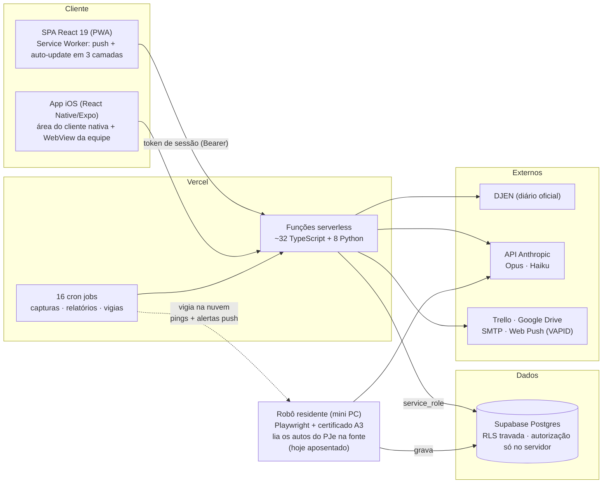
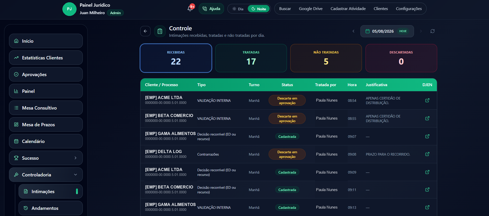
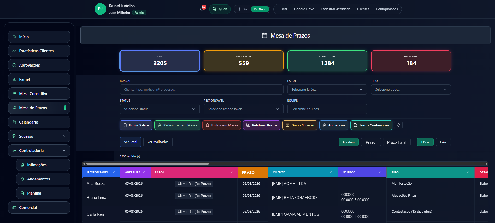
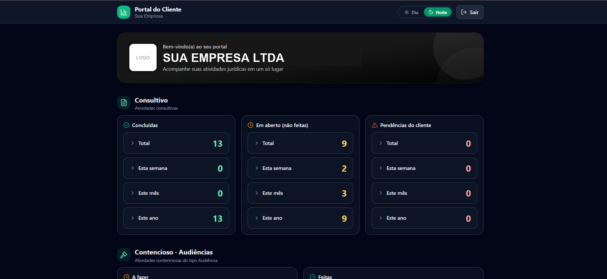
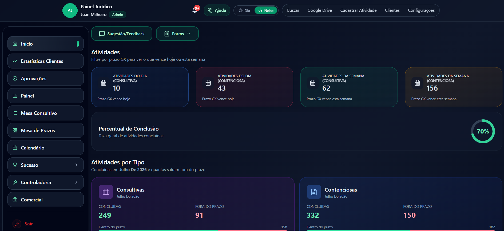

# Legal Ops AI — Case Study de Produção

> **[English version →](./README.md)**

Plataforma de operações jurídicas que eu projetei, construí e opero sozinho para um escritório de advocacia multi-equipes no Brasil. Em produção desde **maio de 2026**, usada diariamente pelo escritório inteiro — advogados, controladoria, sucesso do cliente e os próprios clientes do escritório.

Este é um **repositório de case study**: o produto é proprietário e o código completo permanece privado. O que você encontra aqui é a arquitetura, as decisões de engenharia, trechos de código sanitizados dos pipelines de IA e as lições de operar LLMs em produção. Todos os nomes, partes e números de processo nos exemplos são fictícios.

---

## Os números

| | |
|---|---|
| Em produção | desde maio/2026, sem time de ops — só eu |
| Processos acompanhados | ~1.060 em toda a carteira do escritório |
| Pipelines de IA entregues em produção | 3 — classificação do diário oficial e resumo em lote seguem rodando; o robô de autos foi aposentado deliberadamente (história abaixo) |
| Funções serverless | ~40 (TypeScript + Python, mesmo repo, mesmo deploy) |
| Jobs agendados | 16 crons na Vercel (capturas, relatórios, pushes, vigias) |
| Clientes | PWA mobile-first + app iOS nativo na App Store |

## O que a plataforma faz

O escritório vive e morre por **prazos judiciais**. A plataforma roda essa operação inteira:

- **Mesas de prazos** — quadros de atividades contenciosas e consultivas com sistema de faróis guiado por duas camadas de prazo (o prazo interno do escritório vs. o prazo fatal legal)
- **Controladoria do diário oficial (IA)** — captura automaticamente toda publicação endereçada ao escritório no DJEN, o **Claude Opus** lê e classifica cada uma, o prazo legal é calculado deterministicamente, e vira atividade rastreada em 1 clique
- **Robô judicial (IA)** — robô residente que logava no PJe com certificado A3 (smartcard), lia os autos direto da fonte primária, e o **Claude Haiku** produzia um briefing de analista por movimentação — rotulado por gravidade: *agir / olhar / registro / rotina*. Entregue, operado e depois aposentado deliberadamente ([a história completa](#2-análise-de-autos--claude-haiku-lendo-os-pdfs-do-processo))
- **Portal do cliente** — cada empresa cliente tem seu próprio dashboard (white-label, incluindo o app iOS)
- E mais: filas de aprovação em duas etapas, CRM de leads, relatórios mensais `.docx` por cliente com upload no Google Drive, relatórios diários por equipe via e-mail, web push self-hosted, trilha de auditoria completa com soft delete, sync 1-way com Trello.

## Arquitetura



Regra de projeto nº 1: **o navegador nunca fala com o banco.** Auth é um esquema próprio de token de sessão (senhas em Argon2id); toda leitura/escrita passa por uma função serverless que re-checa papel e equipe no servidor. Esconder botão é cosmético — a função é o portão.

Regra de projeto nº 2: **um repo, um deploy.** Funções TypeScript e Python convivem lado a lado; um `git push` na main sobe frontend, backend, crons e headers atomicamente.

## A engenharia de IA (a parte interessante)

### 1. Classificação do diário oficial — Claude Opus + motor determinístico de prazos

Duas vezes ao dia, uma função Python captura toda publicação endereçada ao escritório no diário oficial. Cada uma passa pelo Opus com um **prompt de extração estruturada** que retorna JSON estrito:

```
rito · instância · tipo de decisão · exige ação do escritório?
é audiência? · prazo literal escrito no texto · resumo do tema
qual parte é nosso cliente · confiança 0..1 · precisa_revisao
```

A decisão-chave: **o LLM nunca calcula prazo.** Prazo processual brasileiro é matemática de calendário com regras (dias úteis, contagens por rito, estratégia de ED primeiro) — isso fica num motor Python determinístico **validado contra o gabarito real do escritório**. O modelo só extrai o que código não consegue interpretar da prosa jurídica livre. Ver [`excerpts/docket_classifier.py`](./excerpts/docket_classifier.py).

O prompt não é genérico: ele codifica a doutrina operacional real do escritório (ex.: *"intimação para pagar é decisão do cliente, não peça do advogado — classifique como validação interna mesmo havendo prazo"*). Quando o modelo erra, a correção entra no prompt como entraria no manual de um analista júnior.

**Human-in-the-loop por design:** nada vira prazo rastreado sem alguém clicar em *Cadastrar* — e nada é descartado sem aprovação do líder da equipe. A IA propõe; o fluxo dispõe.

### 2. Análise de autos — Claude Haiku lendo os PDFs do processo

O robô residente loga no PJe com certificado físico (Playwright + automação de UI do Windows + TOTP), puxa a **timeline e os PDFs reais** de cada processo pela API autenticada, e envia ao Haiku como document blocks nativos — sem pipeline de OCR, sem etapa de extração de texto.

O system prompt é um **manual de analista** escrito à mão — um método de 7 perguntas que o modelo aplica como raciocínio interno, proibido de aparecer na saída. O contrato de saída é fixo: etiqueta de gravidade (**AGIR / OLHAR / REGISTRO / ROTINA**), resumo do processo em um parágrafo e — só quando exige ação — uma ficha estruturada. Ver [`excerpts/docket_analyst.py`](./excerpts/docket_analyst.py).

**Tiering de modelo pelo custo do erro:** Opus para a classificação que cria prazos legais (volume baixo, custo de erro catastrófico), Haiku para leitura de autos em volume (um resumo ruim é chato, não perigoso). Mesma plataforma, dois preços, escolhidos de propósito.

**Epílogo — entregue, medido, aposentado.** Essa foi a engenharia mais difícil do projeto (login com certificado físico, throttling imposto pelo WAF, estado à prova de queda numa máquina que é desligada da tomada) — e funcionou. Mas o relatório semanal de cobertura repetia a verdade inconveniente: o robô só alcançava ~39% da carteira — o resto vivia em outros tribunais ou atrás de habilitações pendentes na OAB — então o fornecedor legado de dados nunca poderia ser desligado. Quando a necessidade que ele atendia passou, eu o desativei em vez de pagar indefinidamente o custo operacional de duas fontes sobrepostas. Aposentar um pipeline que funciona porque os dados mandam é tão engenharia de IA quanto entregá-lo.

### 3. Operar LLM em produção — o que quebrou de verdade

As partes que só se aprendem rodando isso por meses:

- **Drift no formato da resposta.** Uma integração de resumo em lote mudou o shape do payload em silêncio; o parser passou a devolver vazio. Correção: parse defensivo + marcador de log pesquisável para "resposta não bateu" — o próximo drift é uma busca no log, não um mistério.
- **Inanição por ordenação.** Um job horário de captura ordenava ascendente com limite de resultados — quando o backlog cresceu além do limite, *o dia atual nunca chegava*. Bug clássico de paginação, mas com um pipeline de IA na jusante parece que "a IA parou de funcionar". Correção: ordem descendente + janela maior.
- **Ancorar no tempo do evento, não da captura.** Resumos eram datados por quando o robô os *viu*, não por quando *aconteceram* — balde de dia errado em todo relatório. Backfill de 35 linhas.
- **A máquina desliga.** O robô roda num mini PC de escritório. A janela de captura de alertas é **adaptativa** — dimensionada pelo intervalo desde a última execução bem-sucedida — então queda de energia não perde nada. Um cron vigia na nuvem checa o heartbeat de hora em hora e dispara push se ele silenciar — ver [`excerpts/robot_watchdog.ts`](./excerpts/robot_watchdog.ts).
- **A fonte te bane.** O WAF do tribunal bane rajadas; as capturas são throttled e distribuídas em três laços defasados (`:00` caixa / `:30` gotas / `:45` gatilho por alerta).
- **Conheça sua cobertura.** O robô cobria 39% da carteira (o resto era outros tribunais ou habilitação pendente na OAB) — medido por relatório semanal de cobertura, que é por que o fornecedor legado nunca pôde ser desligado, e no fim o que embasou a decisão de aposentar o robô. Se você não mede cobertura, não tem um pipeline — tem uma demo.

## Destaques de engenharia além da IA

- **Auto-update do PWA em 3 camadas** — depois de cada deploy, toda aba aberta se atualiza educadamente (reload em idle/aba oculta, rota preservada). Ninguém no escritório jamais ouviu "limpa o cache".
- **Web push self-hosted** (VAPID, sem Firebase): alertas de prazo, resumos da controladoria, alertas do vigia do robô.
- **Auditoria por soft delete** — exclusões movem linhas para tabelas espelho `exc_*`; nada se perde, exclusão em massa restrita a um admin.
- **Python serverless com restrições reais** — o gerador de relatório mensal estourava o limite de 300 s reconstruindo credenciais do Drive por cliente; cache resolveu, e `maxDuration: 800` cobre a cauda.
- **Postura de segurança** — RLS travada de forma que a chave pública anon não consegue nada; verificado com pentest de verdade na minha própria API. Senhas só em Argon2id (coluna SHA-256 legada dropada após a migração).

## Screenshots

*Todos os dados nas capturas são fictícios (censurados a partir de telas de produção).*

**Controladoria — visão Controle do dia**: toda publicação capturada do diário oficial, classificada pelo Claude Opus e acompanhada no fluxo human-in-the-loop (cadastrada / descarte aguardando aprovação do líder):



**Mesa de Prazos** — o quadro contencioso: faróis em duas camadas (prazo interno vs. prazo fatal legal), filtros salvos, ações em massa, visões por equipe:



**Portal do Cliente** — cada empresa cliente tem seu dashboard white-label (também entregue como app iOS nativo):



**Início** — os números fechados do mês anterior por tipo de atividade (concluídas × fora do prazo), mais o que vence hoje e nesta semana:



## Stack

React 19 · TypeScript · Vite 7 · Tailwind · PWA (Service Worker custom) · Vercel Functions (Node + Python) · Supabase Postgres · API Anthropic (Claude Opus / Haiku) · Playwright · React Native/Expo · web-push · nodemailer · Google APIs

---

*O código completo é privado (ele opera um escritório de advocacia real). Os trechos aqui são sanitizados: identidades removidas, exemplos fictícios, lógica real. Fico feliz em detalhar qualquer parte — [abra uma issue](../../issues) ou me chame.*
